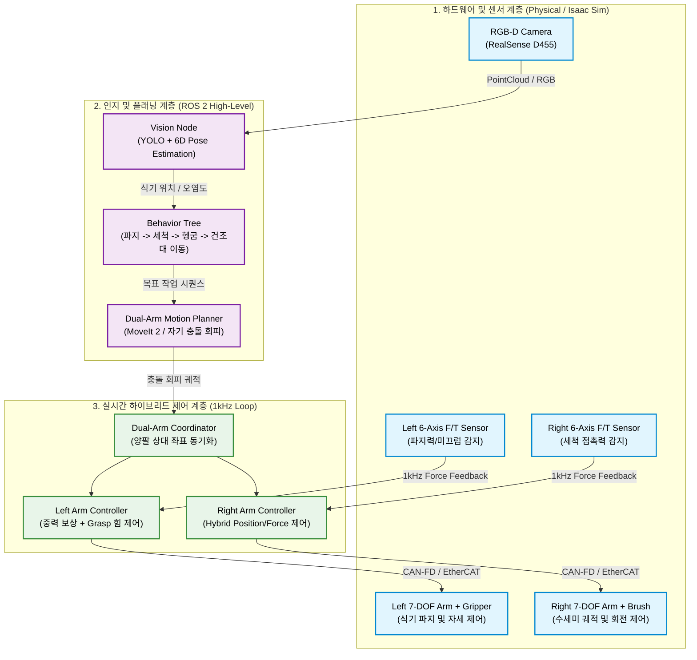

# 🍽️ Dual-Arm 7-DOF Home Dishwashing Robot System
> **가정용 주방 환경을 위한 고하중·방수 양팔 협동 설거지 로봇 설계 및 제어 통합 프로젝트**


## 📌 1. 프로젝트 개요 (Overview)
본 프로젝트는 **좁은 가정용 싱크대 환경**에서 일반 식기뿐만 아니라 **무거운 냄비와 프라이팬까지 파지 및 세척**할 수 있는 **7자유도 양팔(Dual-Arm) 협동 로봇 시스템**의 기구부(H/W) 설계 및 제어 소프트웨어(S/W) 아키텍처를 다룹니다.

### 🎯 핵심 엔지니어링 목표
* **협소 공간 극복 (7-DOF Redundancy):** 표준 가정용 싱크볼(`800×500×250mm`)과 수전(수도꼭지) 간섭을 회피하기 위한 여유 자유도 확보 및 양팔 자기 충돌 회피(Self-Collision Avoidance).
* **고하중 조리도구 대응 (Payload 5kg):** 물이 고인 무거운 냄비나 프라이팬 손잡이의 회전 모멘트를 견디는 고토크 관절 설계 및 미끄러짐(Slip) 보상 제어.
* **곡면 추종 하이브리드 힘 제어:** 프라이팬 코팅 손상을 방지하면서 눌어붙은 이물질을 제거하기 위한 수직 항력(`15N ± 2N`) 유지 제어.
* **Sim-to-Real 파이프라인 구축:** 실제 하드웨어 제작 전 **NVIDIA Isaac Sim**에서 물기·거품 환경 및 양팔 협동 궤적을 사전 검증.

---

## 🏗️ 2. 시스템 아키텍처 (Control Architecture)



---

## 📂 3. 워크스페이스 구조 (Directory Structure)

```text
dishwashing_robot_ws/
├── docs/                        # 하드웨어 부품 선정표(BOM) 및 조인트 토크 계산서
├── isaac_sim_assets/            # 가상 주방 환경(.usd) 및 ROS 2 브릿지 자동화 스크립트
└── src/
    ├── dishbot_description/     # 7-DOF 양팔 URDF/Xacro 모델 및 충돌 메쉬
    ├── dishbot_moveit_config/   # MoveIt 2 양팔 플래닝 그룹 및 충돌 허용 행렬(SRDF)
    ├── dishbot_control/         # C++ 기반 실시간 하이브리드 힘 제어 및 미끄럼 감지 노드
    ├── dishbot_perception/      # RGB-D 기반 식기 6D 자세 추정 및 잔여 오염도 판별 노드
    └── dishbot_bringup/         # Sim-to-Real 통합 실행 Launch 및 Behavior Tree 시퀀스
```

---

## 🛠️ 4. 하드웨어 주요 사양 (Hardware Specs)
상세 부품 선정 근거 및 숄더 조인트 최대 토크 계산 수식은 [`docs/bom_and_torque_calc.md`](./docs/bom_and_torque_calc.md)를 참조하세요.

* **자유도 (DOF):** 양팔 각 7자유도 (총 14-DOF)
* **가반 하중 (Payload):** 한 팔당 최대 5.0 kg (정격 3.5 kg)
* **작업 반경 (Reach):** 700 mm (가정용 싱크대 전 영역 및 건조대 커버)
* **방수 등급 (IP Rating):** 관절부 IP65 / 손목 끝단 및 엔드이펙터 IP67

---

## 🚀 5. 빌드 및 실행 방법 (Getting Started)

### 사전 요구사항 (Prerequisites)
* Ubuntu 22.04 LTS / ROS 2 Humble
* NVIDIA Isaac Sim 2023.1.1 이상 (VRAM 12GB 이상 권장)
* MoveIt 2 & `ros2_control` 패키지

### 빌드 (Build)
```bash
cd ~/dishwashing_robot_ws
colcon build --symlink-install
source install/setup.bash
```

### 시뮬레이션 실행 (Simulation Bringup)
```bash
# 1. Isaac Sim 가상 주방 환경 및 ROS 2 브릿지 실행
~/.local/share/ov/pkg/isaac_sim-*/python.sh isaac_sim_assets/scripts/setup_omnigraph_ros2.py

# 2. MoveIt 2, 제어기, 인지 노드 통합 실행
ros2 launch dishbot_bringup sim_bringup.launch.py
```

---

## 📊 6. 시뮬레이션 검증 결과 (Verification) *(진행 예정)*
* [ ] **Scenario A:** 협소 싱크볼 내 수전 회피 및 양팔 최소 안전거리 유지 검증
* [ ] **Scenario B:** 저마찰(비눗물) 조건에서 프라이팬 미끄러짐(Slip) 감지 및 파지력 보상
* [ ] **Scenario C:** 오목한 냄비/웍 곡면 추종 시 수직 접촉력(`15N`) 추종 오차 분석
